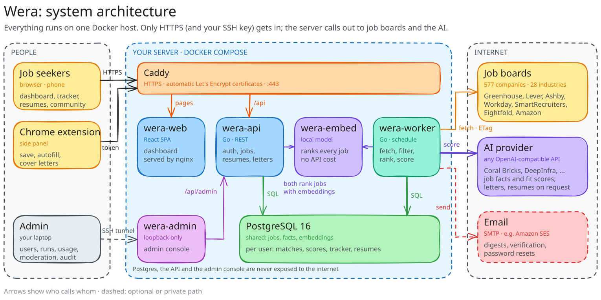
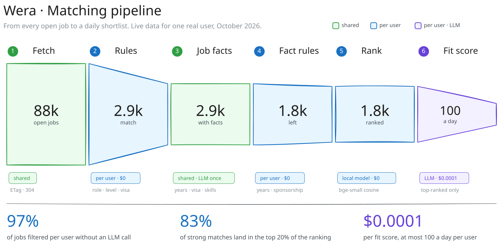

# Wera

[](https://github.com/jessechumo/Wera/actions/workflows/ci.yml)
[](https://github.com/jessechumo/Wera/actions/workflows/ci.yml)
[](https://github.com/jessechumo/Wera/releases)
[](go.mod)
[](https://www.conventionalcommits.org)
[](LICENSE)

**Wera** (Swahili slang for a job or gig) is a self-hosted job radar. It collects postings from public job-board feeds (Greenhouse, Lever, Ashby, Workday, SmartRecruiters, Oracle Recruiting Cloud, Workable, Rippling, Eightfold, and amazon.jobs) for 5,100+ companies across 30 industries (tech firms, but also hospitals, schools, retailers, restaurants and nonprofits), filters them with configurable rules, scores each one against your resume with an LLM from any OpenAI-compatible provider (presets for [Coral Bricks](https://www.coralbricks.ai) and [DeepInfra](https://deepinfra.com)), and serves the results through a REST API. Wera does not apply on your behalf. You review the matches and apply yourself.

The dashboard lives in [wera-frontend](https://github.com/jessechumo/Wera-Frontend), and the Chrome extension (save jobs from any page, cover letters, tailored resumes, filling applications) in [wera-extension](https://github.com/jessechumo/wera-extension).

## Architecture

<picture>
  <source media="(prefers-color-scheme: dark)" srcset="docs/architecture-dark.svg">
  
</picture>

Everything runs with Docker Compose on one host (see [deploy/hetzner](deploy/hetzner)). Caddy is the only public service: it terminates TLS and sends `/api/*` to `wera-api` and everything else to `wera-web` (nginx serving the dashboard). `wera-api` and `wera-worker` are the same Go binary: the API serves requests and sends queued email, the worker runs the matching pipeline on a schedule. Both rank jobs with `wera-embed`, a small local embedding model, and keep everything in PostgreSQL. `wera-admin` listens on 127.0.0.1 only and is reached through an SSH tunnel.

## How matching works

<picture>
  <source media="(prefers-color-scheme: dark)" srcset="docs/pipeline-dark.svg">
  
</picture>

1. **Fetch** each company's board once, for everyone. Boards that support ETags answer `304 Not Modified` when nothing changed; Workday boards list only new postings, with a full sweep once a day. A shared throttle keeps requests few and spaced out.
2. **Store** only new or changed postings (by content hash), with a bulk `COPY`.
3. **Filter** per user with `config/roles.yaml` and their preferences: role families, seniority, US-only, and explicit sponsorship refusals. No LLM cost; a new user's 40,000 jobs take about 4 seconds.
4. **Rank locally** with TF-IDF against the user's profile. These estimates show a new user ranked matches within seconds of signing up.
5. **Extract shared facts** once per posting with the LLM: seniority, years required, sponsorship (the quote must appear verbatim in the posting), work mode, skills and a short digest. Every user reuses them.
6. **Exclude on facts** at no cost: jobs needing too many years, refusing sponsorship, outside the US or too senior never reach a per-user call.
7. **Rank without AI**: each posting's facts and each profile are embedded once by a local model (the `wera-embed` container, no API cost). Every remaining job is ranked by a blend of that embedding similarity (counted double), word matching between the facts and the profile's roles and skills, and the share of required skills the profile names, minus a penalty when the posting asks for more years than the user accepts. Postings without facts yet are ranked by word matching on their text.
8. **Score fit** per user, for the best-ranked jobs only: at most `SCORES_PER_DAY` per user (default 100, at most `SCORES_PER_RUN` per run once their profile has scores; users away for a week get just enough for their digest). The call sends a compact job card plus the cached profile and returns only a score, a verdict and one sentence; matched and missing skills are worked out in code. Jobs below the cut keep their estimate, and opening one scores it immediately.

Measured on the development data: a new account is ready in about 5 seconds. On 903 AI-scored jobs from six profiles, the blend puts 60% of the jobs the AI rates 70+ in a user's top fifth (bge-small embeddings alone: 43%), and its order agrees with the AI's (Spearman 0.66, against 0.45). The blend weights were chosen by leave-one-user-out validation. A fit call costs about $0.00018 (it was $0.00057 before the shorter reply and cache warm-up), and with the limit a user's scoring costs roughly a tenth of scoring every candidate.

## Features

- **Matching:** per-user filters, local estimates, shared facts, and fit scores with reasons, skills matched and missing, and the sponsorship quote. The AI rates each part of fit 0-10 against fixed anchors (role, seniority, skills, domain, location, and blockers such as a clearance or license); the score is computed from those ratings and the measured coverage of the job's required skills, so it uses the whole 0-100 range instead of a model's favourite numbers
- **Resumes:** each user keeps a structured resume (imported exactly from LaTeX in the popular "Jake's resume" template or Wera's own, converted from the uploaded resume by the AI with every line copied verbatim, or started from the template), rendered with [Typst](https://typst.app) in about 50 ms in four templates: Ivy (classic LaTeX), Parse (ATS-first), Signal (modern, accent color) and Ledger (serif), on US Letter or A4, with bundled fonts (Inter, Source Sans 3, SIL OFL). Every template also exports LaTeX that compiles with pdfLaTeX, XeLaTeX or LuaLaTeX and reads back into the editor. A deterministic review scores each resume (weak openers, pronouns, metrics, length, consistency, section names), and AI suggestions rewrite single bullets without adding facts or numbers. Fitting to one page tries the most readable layout first (down to 10pt) and only then drops the fewest low-priority bullets. Live SVG previews, PDF and `.tex` export, and keyword coverage against each posting. A tailored copy per job reorders skills and rewords bullets through ids only (no new roles, numbers or skills), and drops the bullets least relevant to the job only when the page is full
- **Cover letters:** written for one job from the user's profile and resume without repeating the resume; editable, with dashes cleaned out
- **Community:** a blog for offers, interview experiences and tips, with comments and reactions; every post and comment is reviewed by an AI moderator first (violence, harassment, cheating or faked credentials, spam, off-topic) and refused with a reason
- **Interview prep:** multiple-choice questions by domain (algorithms, system design, databases, OS and networking, ML, behavioral) and difficulty, with explanations and progress
- **Sponsorship:** what each company's postings say about visa sponsorship (from data already extracted while scoring), beside its certified H-1B applications from the US Department of Labor's LCA disclosure files: counts, new hires, offered wages by job title, place and wage level, a lookup for any employer, and in each job view what the company offered for similar titles at that job's level
- **Chrome extension API:** revocable per-browser tokens, application details (filled into forms), jobs saved from any page or the dashboard (deduplicated across users, scored, added to the tracker, then rule-filtered and scored for every other user they suit; added postings close after 45 days), AI reading of job pages (the description is cut from the page text, never retyped), drafted answers to application questions, and the tailored resumes above (the extension attaches the tailored PDF)
- **Admin API** (`/api/admin/*`, for the [wera-admin](https://github.com/jessechumo/wera-admin) app): service overview, accounts (budget, admin role, sign out everywhere, delete with the email as confirmation), pipeline runs and AI usage, company fetch health, moderation of community posts and comments (publish, hide, delete), email outbox and tests. Every change lands in an audit log; extension tokens never reach these routes.
- **Accounts:** sessions, profile pictures, resume viewing, settings (theme, default sort, notification preferences, hidden companies), CSV export, account deletion
- **Operations:** Prometheus metrics, per-user and global monthly LLM budgets, maintenance-aware scheduling, version in `/healthz`

## H-1B data

The Sponsorship page and job view use the US Department of Labor's public LCA disclosure files (certified Labor Condition Applications, which employers file before hiring or extending someone on an H-1B). Download the quarterly "LCA Programs (H-1B, H-1B1, E-3)" files from the [OFLC performance data page](https://www.dol.gov/agencies/eta/foreign-labor/performance) in a browser (the site refuses scripted downloads), then load them:

```bash
wera h1b import LCA_Disclosure_Data_FY2025_Q4.xlsx LCA_Disclosure_Data_FY2026_Q3.xlsx
wera h1b status
```

A file covers one quarter or the fiscal year to date (up to 450,000 rows, 250 MB, about 4 minutes to load); cases already loaded are skipped, so overlapping files and reloads add nothing. Only business fields are stored, never the contact or attorney names and emails in the files. Employers are matched to tracked companies by name; a company that files under another legal name gets `h1b_names` in `config/companies.yaml` (for example SpaceX files as Space Exploration Technologies), then `wera h1b match`.

## Email

Email is built but off until a provider is set. With it on, Wera confirms new accounts' addresses, sends password reset links (single use, one hour, and every session ends), and can send daily digests and strong-match alerts from templates with HTML and plain-text versions. Mail is queued in the database and delivered with retries, so a slow provider never slows a request.

```bash
wera mail preview --out email-preview      # every template with sample data; open the .html files
wera mail digest --email you@example.com    # your real digest, rendered to a file (sends nothing)
```

Admins can also preview each template, and send a test, from the admin app (wera-admin).

To turn it on, set `MAIL_PROVIDER=smtp`, `MAIL_FROM`, `PUBLIC_URL` and the `SMTP_*` settings (see `.env.example`), then check with `wera mail test --to you@example.com`. For the mail to reach inboxes, add the sending domain's SPF and DKIM records from your provider, and a DMARC record such as `v=DMARC1; p=quarantine; rua=mailto:dmarc@your-domain.com`. `MAIL_PROVIDER=log` writes messages to the log (and `MAIL_LOG_DIR`) instead of sending them, for development.

## Switching AI providers

Every AI call goes through one OpenAI-compatible client, configured by `AI_*` settings:

```bash
AI_PROVIDER=deepinfra          # coral (default) | deepinfra | openai
AI_API_KEY=...
AI_MODEL=deepseek-ai/DeepSeek-V4.1-Flash   # optional: each preset has a default
```

`openai` means any compatible API (OpenAI, Together, a local vLLM server): set `AI_BASE_URL` and `AI_MODEL` too. Budgets need a price per model: known models are in `internal/scoring/prices.go`, others take `AI_PRICE_INPUT`, `AI_PRICE_CACHED_INPUT` and `AI_PRICE_OUTPUT` (USD per 1M tokens). When a provider reports its own cost per call (Coral, DeepInfra), that figure is used. `AI_EXTRA_BODY` adds model-specific request fields as JSON. Analyses are cached per profile text and scoring method, so switching models keeps existing scores; new ones come from the new model. A new scoring method (`scoring.Version`) scores jobs again on the next runs, best first, while their old scores keep showing; rescores do not count against `SCORES_PER_DAY`.

## Make it yours

Wera is driven by configuration and per-user profiles:

- `config/companies.yaml`: the companies to watch, each tagged with an industry from `config/industries.yaml`
- `config/roles.yaml`: the catalog of role families and seniority levels users pick from, plus location and sponsorship rules. Families are grouped into career fields (technology, healthcare and nursing, business, education, creative, engineering and science, trades and services), so a nurse picks "Registered nursing (RN)" the way an engineer picks "Site reliability"
- Each user's profile (stored in the database): the text the LLM scores against and their filter preferences

New users build their profile in the dashboard: they upload a resume PDF (or paste the text), answer a short questionnaire (experience, work authorization, locations, work modes, industries, target roles) and pick role families and seniority levels. The LLM drafts the profile from the resume and answers, the user reviews and edits it, and saving it filters and ranks their jobs on the spot.

## Quick start

Requirements: Go 1.27+, Docker, and an API key for an OpenAI-compatible LLM provider (`AI_PROVIDER=coral`, `deepinfra`, or `openai` with `AI_BASE_URL`; see `.env.example`). Resume rendering needs [typst](https://github.com/typst/typst/releases) 0.14 on `PATH` (or `TYPST_BIN`); the Docker image includes it.

```bash
cp .env.example .env                               # set AI_PROVIDER and AI_API_KEY
docker compose up -d postgres
make migrate                                       # create tables
go run ./cmd/wera serve                            # API on http://localhost:8080
```

Then run the dashboard (`../wera-frontend`, `npm run dev`), sign up, and set up your profile. `go run ./cmd/wera pipeline` runs one full fetch, filter, and score for every user.

To use a markdown profile instead of the setup flow, start from [`profile/profile.example.md`](profile/README.md), create an account and import it (`export-profile` writes one back out):

```bash
go run ./cmd/wera users create --email you@example.com --admin
go run ./cmd/wera users import-profile --email you@example.com --file profile/you.md
```

## Run as a server

For a VPS with a domain (HTTPS, published images, no source checkout), see [deploy/hetzner](deploy/hetzner/README.md).

To build and run everything in Docker, with the frontend cloned next to this repo as `../wera-frontend`:

```bash
cp .env.example .env            # set AI_API_KEY and a random POSTGRES_PASSWORD
docker compose up -d --build    # postgres, migrations, API, worker, dashboard
```

To stamp the deployed version into the images (shown in `/healthz` and the dashboard footer):

```bash
WERA_VERSION=$(git describe --tags --always) WERA_COMMIT=$(git rev-parse --short HEAD) \
WERA_WEB_COMMIT=$(git -C ../wera-frontend rev-parse --short HEAD) \
WERA_ADMIN_COMMIT=$(git -C ../wera-admin rev-parse --short HEAD) docker compose up -d --build
```

The dashboard is served at `http://<server-ip>:3000` (`WEB_PORT`). Migrations run automatically before the API and worker start. Postgres (`5433`) and the API (`8080`) bind to `127.0.0.1` only, so the dashboard is the only service other machines can reach. Docker-published ports bypass `ufw`, so to limit the dashboard to your LAN, add a rule to the `DOCKER-USER` chain:

```bash
iptables -I DOCKER-USER -p tcp -m conntrack --ctdir ORIGINAL --ctorigdstport 3000 ! -s 192.168.1.0/24 -j DROP
```

The admin console ([wera-admin](https://github.com/jessechumo/wera-admin), checked out beside this repository) is served at `http://<server-ip>:3001` (`ADMIN_PORT`); sign in with an admin account (`wera users admin --email you@example.com`). Its nginx answers private networks only; do not route it through a public tunnel.

Released images are published to `ghcr.io/jessechumo/wera:<version>`.

### Public access

To let people outside your network use Wera, give it a public HTTPS address without opening router ports, for example with a [Cloudflare Tunnel](https://developers.cloudflare.com/cloudflare-one/connections/connect-networks/) to `http://localhost:3000` (or host the dashboard on Vercel and tunnel the API). Then set `COOKIE_SECURE=true`, `TRUST_PROXY=true`, and `PUBLIC_ORIGINS=https://<your-domain>` in `.env` and restart. Served over HTTPS, the dashboard's HSTS header stops downgrade attacks.

Until there is a domain, the `public` compose profile does this with no account: a second API instance (`wera-api-public`, secure cookies, proxy headers trusted) behind a Cloudflare quick tunnel, while `wera-api` keeps serving the LAN over plain HTTP.

```sh
PUBLIC_ORIGINS=https://<your-app>.vercel.app   # in .env
docker compose --profile public up -d wera-api-public wera-tunnel
docker logs wera-tunnel 2>&1 | grep -o 'https://[a-z0-9-]*\.trycloudflare\.com'
```

Put that address in the frontend's `vercel.json`. It changes whenever `wera-tunnel` restarts, so switch to a named tunnel once a domain exists.

### Accounts

Every API route except signup and login needs a session. People sign up in the dashboard (turn this off with `SIGNUP_ENABLED=false`; `SIGNUPS_PER_HOUR` limits sign-ups per IP), or you create accounts from the shell; `create` and `passwd` print a generated password:

```bash
docker exec wera-api /app/wera users create --email you@example.com --name You --admin
```

Admins can trigger runs and see overall usage and each user's spend. Everyone shares one AI provider key, so spending is capped three ways: per user per run (`MAX_COST_PER_RUN_USD`), per user per month (`USER_MONTHLY_BUDGET_USD`, default $10; change one user's with `wera users budget`), and for all users together per month (`MAX_MONTHLY_COST_USD`). Jobs over a limit stay pending until the next month or a higher budget.

## Being a good citizen to job boards

Wera reads the same public JSON endpoints the companies' own career pages use, and it keeps its footprint small: conditional requests (ETags, so unchanged boards cost a `304`), incremental listing on Workday with one full sweep a day, details fetched only for postings it has not seen, a shared throttle (a few concurrent requests, spaced out), per-run caps, an identifying User-Agent with a contact address, backing off when a board asks (`Retry-After`), and a pause during Workday's weekly maintenance window. Each board is fetched once for all users. If you run Wera publicly, review each provider's terms of use and keep `RUN_SCHEDULE` modest.

## Security

See [SECURITY.md](SECURITY.md) for how to report a vulnerability and a summary of the protections: hashed sessions, per-IP and per-account rate limits, origin checks, a strict Content-Security-Policy, upload limits, and prompt-injection defenses for every AI feature (untrusted text is fenced and model output must match a fixed schema). CI runs `govulncheck` on every change.

## Development

```bash
make build      # bin/wera with the version stamped in
make lint       # golangci-lint
make test       # unit and integration tests (needs WERA_TEST_DATABASE_URL)
make cover      # coverage of internal/...
make vuln       # govulncheck
```

Integration tests need a PostgreSQL database other than the live one (`WERA_TEST_DATABASE_URL`, for example a `wera_test` database migrated with `wera migrate`); they create and clean up their own users, companies and jobs, and refuse to run against a database named `wera`. Without the variable they are skipped locally; in CI they must run. The LLM is replaced by a fake inference server in tests.

## Releases and versioning

Commits follow [Conventional Commits](https://www.conventionalcommits.org) (`feat:`, `fix:`, `perf:`, `docs:`, ...), checked on every pull request. [release-please](https://github.com/googleapis/release-please) turns them into a release PR with the next [semantic version](https://semver.org) and a `CHANGELOG.md`; merging it tags `vX.Y.Z`, attaches Linux binaries, and pushes the Docker image. Until 1.0, a `feat` bumps the minor version and a `fix` the patch. `wera version` and `/healthz` report the running version.

## Commands

| Command | Purpose |
|---|---|
| `wera pipeline` | Fetch, filter, and score once |
| `wera worker` | Run the pipeline at the `RUN_SCHEDULE` times in `RUN_TIMEZONE` (or every `RUN_INTERVAL` when no schedule is set) |
| `wera serve` | REST API, `/healthz`, and Prometheus `/metrics` |
| `wera discover "Name"` | Find a company's job board on Greenhouse, Lever, or Ashby |
| `wera companies validate` | Check `companies.yaml` |
| `wera refilter --all [--user E]` | Reapply `roles.yaml` rules to existing jobs (no LLM cost) |
| `wera rescore --all [--user E]` | Rescore after changing profiles |
| `wera deep --top N [--user E]` | Longer review of a user's top matches using background mode (Coral or OpenAI Responses API) |
| `wera bench [--user E]` | Measure scoring throughput, cache hit rate, and cost per job |
| `wera users list\|create\|passwd\|admin\|update\|budget\|import-profile` | Manage accounts and profiles from the server shell |
| `wera mail preview \| test \| digest \| send` | Preview email templates, send a test, render a digest, deliver queued mail |
| `wera h1b import FILE.xlsx... \| match \| status` | Load the Department of Labor's H-1B disclosure files (see below), match employers to companies |
| `wera version` | Print the version and commit |

## Extending

- **Add a company:** run `wera discover "Name"`, add it to `config/companies.yaml`, then run `wera companies validate` and `wera pipeline`.
- **Companies found by users:** when someone adds a job (dashboard or extension) from a Greenhouse, Lever, Ashby, SmartRecruiters, Workday, Oracle, Workable or Rippling board that no company has, Wera checks the board once and, if it has open jobs, fetches it every run from then on. These rows have `added_at` set in the `companies` table; set `enabled = false` there to stop one. If `companies.yaml` later lists the same board, the YAML entry takes it over.
- **Add a role type:** add a family with its `field` and title patterns to `config/roles.yaml`; users can then pick it. If a word means seniority in one career but not another ("Staff Nurse", "IV Therapy"), add it to that level's `except` list.
- **Add an industry:** add it to `config/industries.yaml` and tag companies with it.
- **Add a company on Workday:** its token is `tenant.wdN/site` from the career site URL, e.g. `https://nvidia.wd5.myworkdayjobs.com/NVIDIAExternalCareerSite` is `nvidia.wd5/NVIDIAExternalCareerSite`. SmartRecruiters takes the company identifier, Eightfold `host/domain`. Oracle Recruiting Cloud takes `host/site` from `https://<host>.oraclecloud.com/hcmUI/CandidateExperience/en/sites/<site>`, e.g. `jpmc.fa/CX_1001`; Workable and Rippling take the account or board slug from `apply.workable.com/<slug>` and `ats.rippling.com/<slug>`.
- **Add a job board provider:** implement the `Source` interface in `internal/sources` (`ConditionalSource` when it supports ETags, `DetailSource` when the list has no descriptions) and register it.
- **Add interview questions:** insert rows into `interview_questions` (four choices, the index of the answer, and an explanation).

## Project layout

```
cmd/wera              Single binary with subcommands
internal/api          REST handlers (chi), security headers, rate limits
internal/auth         Password hashing, session tokens, rate limiter
internal/buildinfo    Version and commit stamped in at build time
internal/config       Environment, companies, industries and the role catalog
internal/filter       Rule engine driven by config/roles.yaml
internal/moderation   Community moderation: rule checks and the AI review
internal/normalize    HTML to text, content hashing
internal/pipeline     Fetch, filter, rank and score orchestration
internal/profile      Resume text, avatars, profile drafts, cover letters
internal/resume       Structured resumes: Typst rendering, one-page fitting, LaTeX import/export, keywords, AI import and tailoring
internal/mail         Email templates (HTML and text), MIME, SMTP and log providers
internal/notify       Account and job emails: verification, reset, digests, the outbox delivery loop
internal/h1b          H-1B disclosure files: streaming reader, wage normalization, employer name matching
internal/relevance    Local TF-IDF ranking (estimated scores)
internal/scoring      OpenAI-compatible LLM client, prompts, facts, fit, cost accounting
internal/sources      Greenhouse, Lever, Ashby, Workday, SmartRecruiters, Oracle, Workable, Rippling, Eightfold, Amazon adapters
internal/store        PostgreSQL repository (pgx)
internal/testutil     Test database and fixtures
migrations/           Embedded SQL migrations (goose)
docs/                 Architecture and pipeline diagrams (Excalidraw sources in docs/diagrams)
```

## Stack

Go 1.27, chi, pgx, PostgreSQL 16, goose, any OpenAI-compatible LLM (default Coral Bricks `deepseek-v4.1-flash-fast`; DeepInfra `deepseek-ai/DeepSeek-V4.1-Flash`), a local embedding model (Snowflake Arctic Embed M v1.5), Prometheus, Docker Compose, GitHub Actions, release-please.

See `PLAN.md` for the original design.
